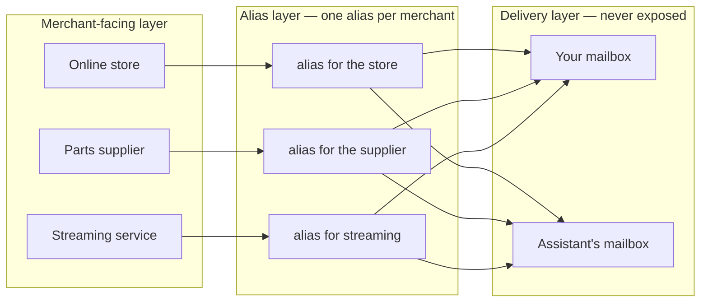
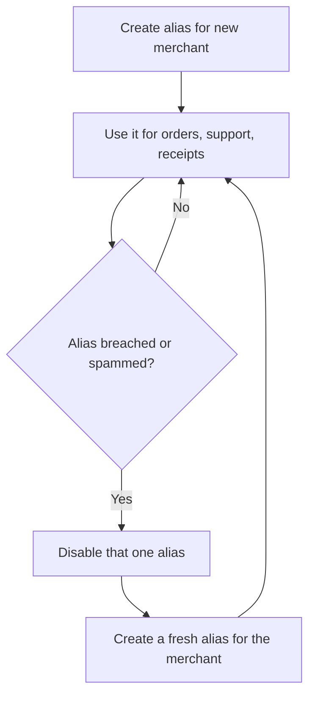

# Dual-delivery aliases

Give every merchant its own email alias, and have each alias deliver to two mailboxes: yours and your assistant's. The merchant never learns a real address, you see everything, and your assistant can act on order email without you forwarding anything. This is the data-segmentation backbone the other use cases build on.

## The problem it solves

An assistant that shops, tracks orders, and handles support for you needs to *see* transactional email: order confirmations, shipping updates, verification codes, refund notices. The usual options are all bad:

- **Forward manually** — you become the assistant's secretary.
- **Share one mailbox** — the assistant sees your personal mail too.
- **Give merchants your real address** — it gets breached, sold, and spammed; one leak poisons every account.

## The pattern

For each merchant or service, create one unique alias (Proton Pass hide-my-email / SimpleLogin). Configure that alias to forward to exactly two destination mailboxes:

1. **Your primary mailbox** — you see every receipt and notice, as usual.
2. **Your assistant's mailbox** — the assistant sees only mail sent to the alias: transactional mail for merchants it manages.

The merchant only ever sees the alias.

## Why this is a data-segmentation strategy

Three layers, each knowing only what it needs:

- **Merchant-facing layer (public, disposable).** One alias per merchant. If an alias leaks or gets spammed, disable just that alias — no other merchant is affected and no real address is exposed.
- **Delivery layer (private, never exposed).** Your real mailbox address is never given to a merchant and never visible to the assistant beyond what arrives through the alias.
- **Assistant layer (scoped).** The assistant receives only alias-routed mail. It has no access to your personal inbox.

The blast radius of a breach is exactly one merchant.

## How it flows

One alias goes bad? Disable just that alias — the other merchants keep working:

## Setup

1. Set up the scoped Proton Pass agent integration first — see [Proton Pass integration](../proton-pass-integration/). That gives your assistant its own vault and the ability to create aliases without seeing your other vaults.
2. Decide the destination mailboxes with the human up front: exactly which mailbox(es) each alias forwards to. Both the human's and the assistant's mailbox must exist before aliases are created. Never assume defaults.
3. For each new merchant account, create one unique alias and set both mailboxes as forwarding destinations.
4. Use the alias — and only the alias — as the contact email for that merchant.

## Standing rules

- One alias per merchant, always. Never reuse an alias across merchants.
- Every alias forwards to both mailboxes. No exceptions, or the assistant goes blind on that merchant.
- Merchants never get a real mailbox address.
- A leaked or spammed alias is disabled and replaced per merchant; other aliases are untouched.
- The assistant may read alias-routed mail to do its job (track orders, pull verification codes, start returns). It never gets access to the human's personal inbox.
